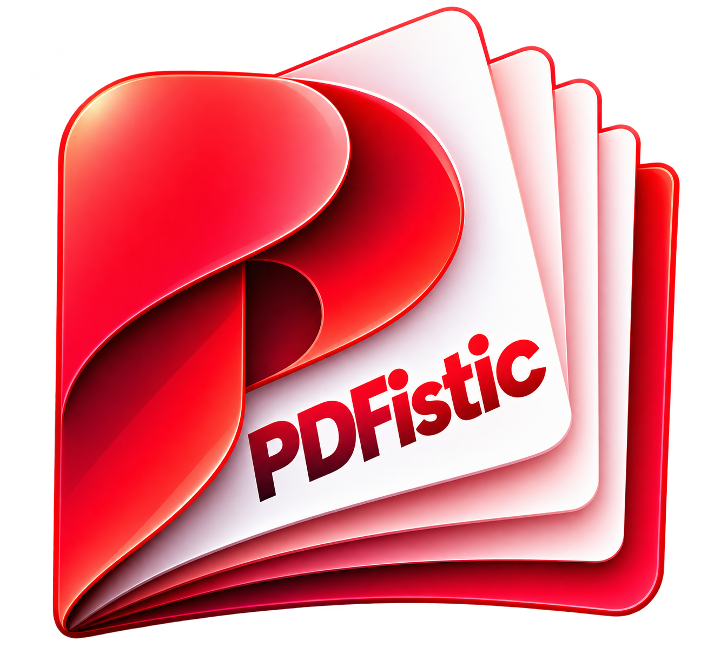
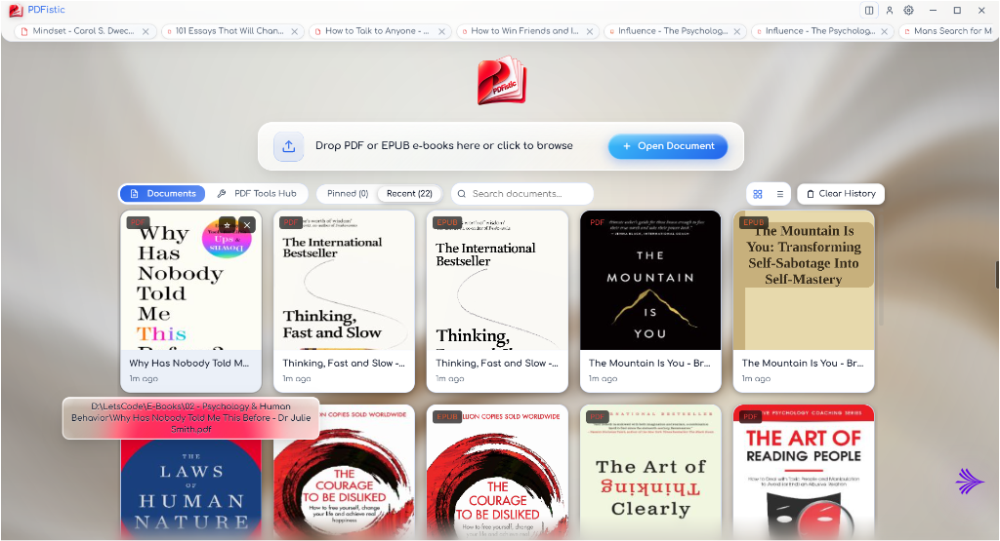
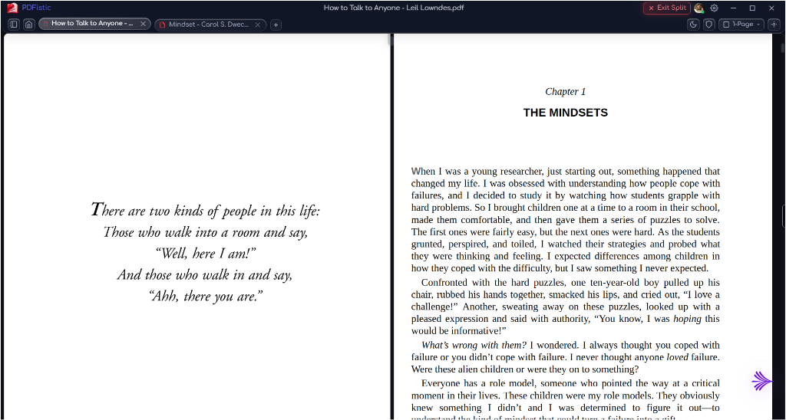
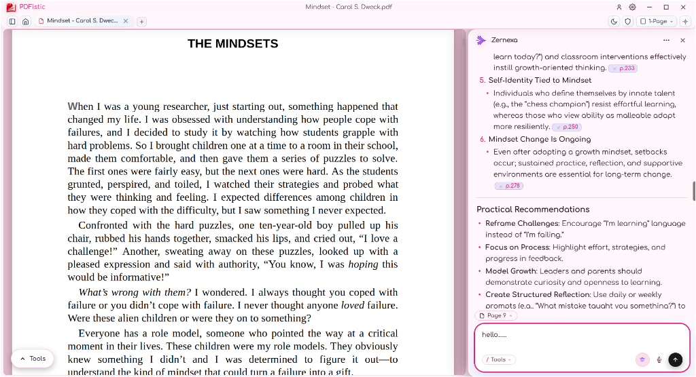
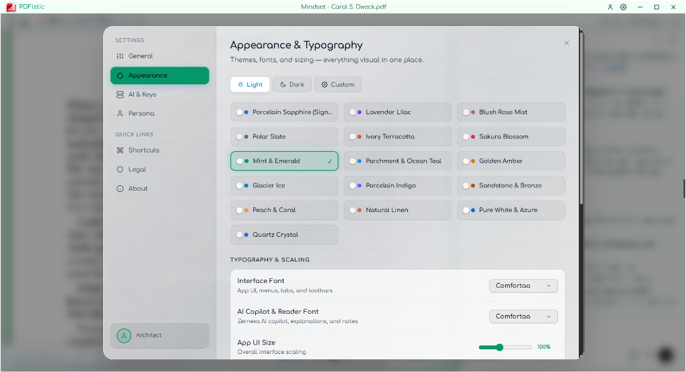
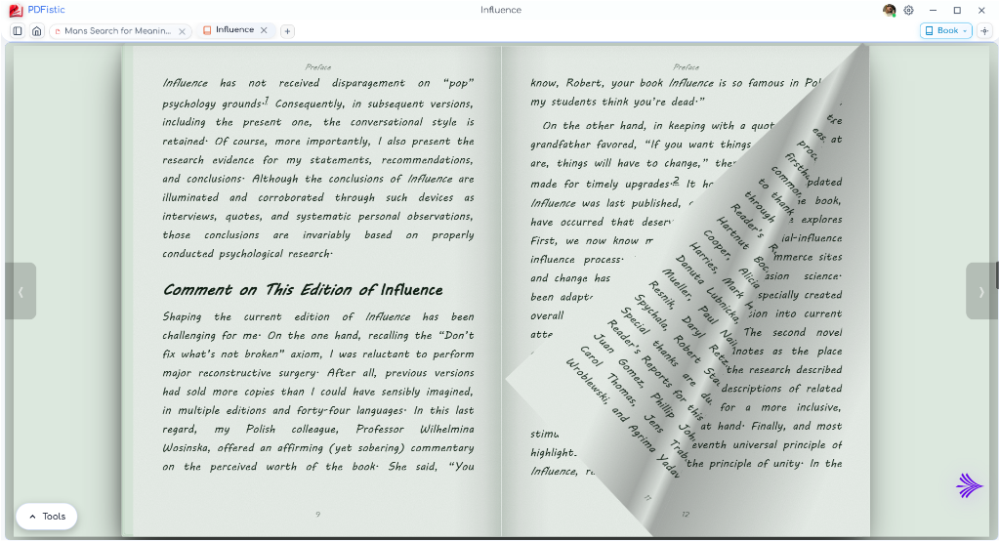
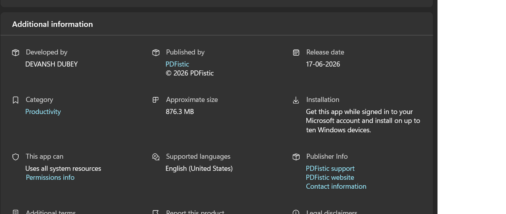

  

  # PDFistic

  **Every book. Every PDF. One calm, distraction-free place to read on Windows.**

  

    
    
    
  

  

    <a href="#features">Features</a> &middot;
    <a href="#feature-tour">Feature Tour</a> &middot;
    <a href="#privacy--local-storage">Privacy</a> &middot;
    <a href="#store-details">Store Details</a> &middot;
    <a href="#contact--links">Contact</a>
  

---

  
  
<em>Offline library shelf with pinned and recent PDFs &amp; EPUBs, multi-tab reading, and local PDF Tools Hub.</em>

---

## Overview

PDFistic is a lightweight, offline-first PDF and EPUB reader for **Windows 10 and Windows 11**. It pairs realistic book-like page flipping, highlighting, pen annotations, and local PDF utilities with an optional AI reading assistant (**Zernexa**) using your own API keys, while keeping every document strictly on your computer.

---

## Features

- **Dual-Page Book Flip & Continuous Reading:** Turn pages naturally in 3D two-page spread mode or read smoothly in continuous 1-page view with thumbnails, outlines, bookmarks, and quick search.
- **Side-by-Side Split View:** Open two documents side by side in independent panes to compare chapters, references, or study notes effortlessly.
- **Annotations, Highlighting & Signatures:** Highlight text, sketch with freehand pen tools, pin margin notes, fill standard PDF form fields, and place digital signatures.
- **Built-in Local PDF Tools Hub:** Merge, split, rotate, reorder, watermark, extract scanned text via offline OCR (`tesseract.js`), and convert images to PDF directly on your PC.
- **Zernexa AI Copilot (Optional BYOK):** Ask questions, summarize sections, or study dense material with clickable page citations (`[p.N]`), KaTeX math formulas, and voice input. Bring your own key (Gemini, OpenAI, Anthropic, Groq, OpenRouter) or connect a local **Ollama** model.
- **Curated Themes & Typography:** Switch between Light, Dark, and Custom color palettes, pick dedicated UI and reader fonts, and scale the workspace comfortably.

---

## Feature Tour

### 1. Side-by-Side Document Comparison

  

### 2. Docked AI Assistant with Clickable Citations

  

### 3. Curated Appearance Themes & Typography

  

### 4. Dual-Page Book View

  

---

## Privacy & Local Storage

- **No Accounts & No Telemetry:** No sign-up required, no ads, and no analytics tracking what you open or read.
- **Files Stay on Your PC:** Your PDFs, EPUBs, highlights, annotations, bookmarks, and recent history remain locally on your Windows device.
- **Encrypted Key Storage:** Optional AI API keys are stored locally using Electron `safeStorage` (**Windows DPAPI**, tied to your Windows user account).
- **Direct Provider Control:** Document text is sent to an AI provider only when you explicitly ask a question in Zernexa (using the provider or local Ollama endpoint you configured).

---

## Store Details

  

- **Availability:** [Microsoft Store (Windows 10 & 11)](https://apps.microsoft.com/detail/9PMCFQL187MN?hl=en-us&gl=IN&ocid=pdpshare)
- **Version:** `2.0.0`
- **Category:** Productivity
- **License:** [Apache License 2.0](LICENSE)

---

## Contact & Links

- **Website:** [Home](https://devanshd07o.github.io/PDFistic-V1/) &middot; [Privacy Policy](https://devanshd07o.github.io/PDFistic-V1/privacy.html) &middot; [Terms of Service](https://devanshd07o.github.io/PDFistic-V1/terms.html) &middot; [Support & FAQ](https://devanshd07o.github.io/PDFistic-V1/support.html) &middot; [Contact](https://devanshd07o.github.io/PDFistic-V1/contact.html)
- **Email:** devanshd07o@gmail.com
- **Bug Reports:** [GitHub Issues](https://github.com/devanshd07o/PDFistic-V1/issues)
- **LinkedIn:** [Devansh Dubey](https://www.linkedin.com/in/devansh-dubey-aa802b305/)
- **Similar Apps:** [Clauzey](https://github.com/devanshd07o/CLAUZEY-V1)

---

  Developed by Devansh Dubey &middot; Published under the <a href="LICENSE">Apache License 2.0</a>.

