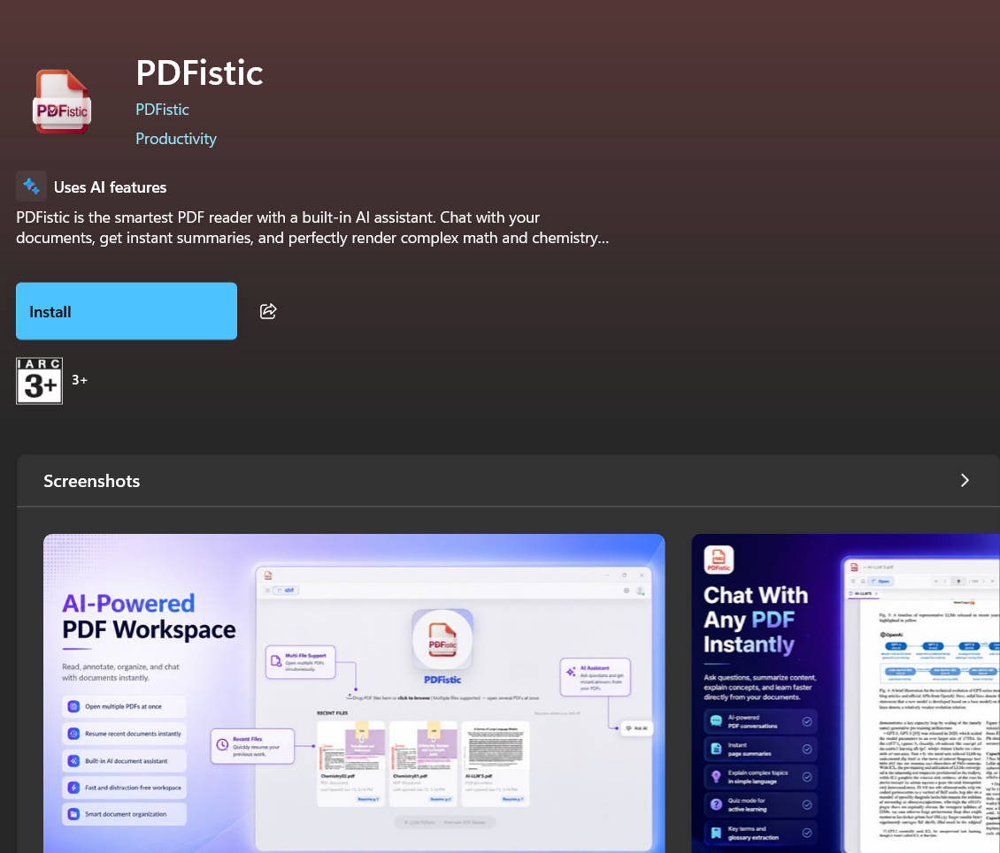
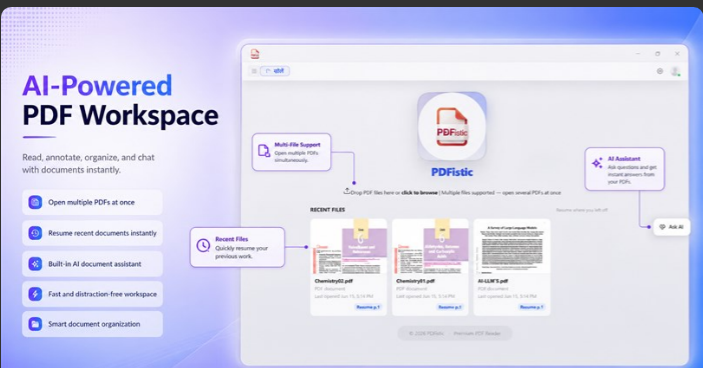
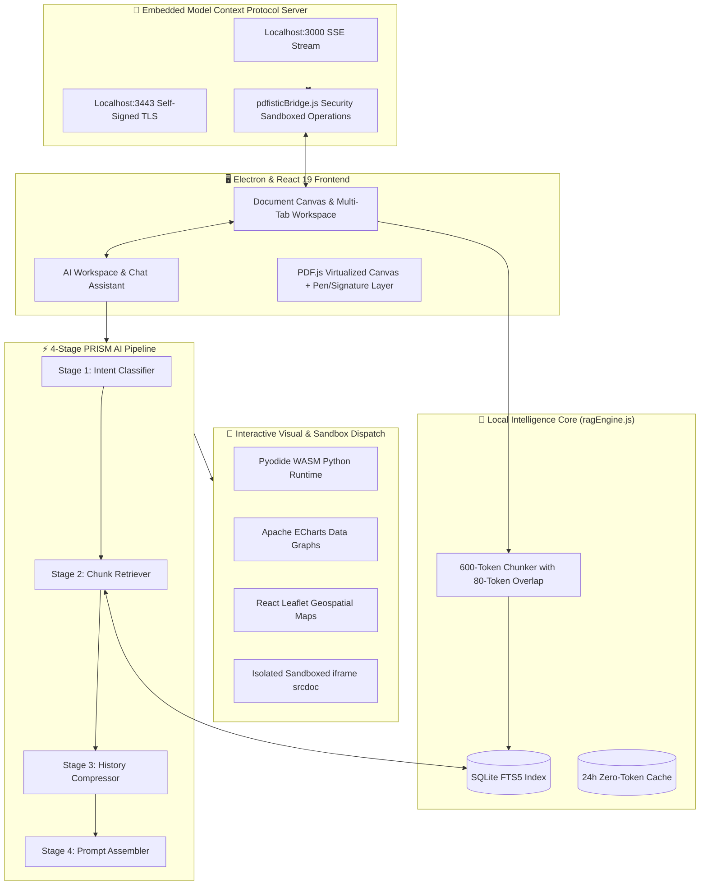
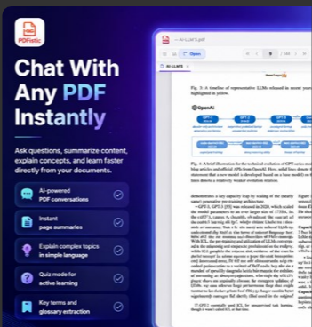

  

    

  

  # PDFistic

  ### The Privacy-First, Agentic Document Intelligence Platform & Desktop PDF Workspace

  

    
    
    
    
  

  

    <b>Acrobat-grade document manipulation</b> meets <b>Local SQLite FTS5 RAG</b>, an <b>Embedded Model Context Protocol (MCP) Server</b>, and a <b>Sandboxed Visual Execution Runtime</b>.
  

  

    <a href="#the-problem--overview">Overview</a> •
    <a href="#key-architecture-highlights">Comparison</a> •
    <a href="#deep-dive-engine--architecture">Architecture</a> •
    <a href="#signature-feature-spotlight">Signature Features</a> •
    <a href="#privacy--security-philosophy">Privacy & Security</a> •
    <a href="#developer--store-verification">Store Verification</a> •
    <a href="#release-timeline--roadmap">Roadmap</a>
  

---

 

  
  
<em>Official Microsoft Store Showcase: Multi-file workspace with on-device recent documents and smart reading assistant.</em>

 

## The Problem & Overview

Modern document interaction is fundamentally broken across two distinct extremes:

1. **Legacy Desktop PDF Readers (Adobe Acrobat, Foxit, Nitro):** Cluttered with legacy bloat, expensive subscription paywalls, and rudimentary or nonexistent intelligence layers that treat documents as static print previews.
2. **First-Gen Cloud AI PDF Wrappers (ChatPDF, AskYourPDF, Web SaaS):** Require uploading sensitive legal, financial, or personal PDF files to third-party servers. They leak confidential data, suffer from token inflation by streaming entire raw files, hallucinate without page citations, and cannot edit, sign, or structurally modify the PDF itself.

**PDFistic bridges this chasm.** It is an on-device, AI-native desktop workspace that delivers full document manipulation alongside an autonomous local intelligence engine. Your documents never leave your device unless you explicitly query an external LLM, and even then, only targeted retrieval chunks are passed.

---

## Key Architecture Highlights

| Architectural Dimension | Generic Cloud AI PDF Wrappers | Traditional PDF Suites (Acrobat Pro) | PDFistic Desktop Workspace |
| :--- | :--- | :--- | :--- |
| **Data Privacy & Ingestion** | Full cloud upload mandatory | Local (No native intelligence) | **100% Local-First** (SQLite FTS5 RAG on device) |
| **Agentic AI Interoperability** | None (Isolated web chatbox) | None | **Embedded MCP Server** (HTTP/SSE & TLS port 3000/3443) |
| **AI Output Presentation** | Markdown text walls | Not applicable | **Interactive Visuals** (ECharts, Leaflet, Pyodide, iframe sandbox) |
| **Code Execution in Chat** | None | Not applicable | **Client-side WASM Python** (Pyodide sandbox) |
| **Token Optimization** | Massive token waste per query | Not applicable | **Zero-Token Repeat Cache** + 600-token chunk overlap |
| **Document Modification** | Read-only | Full editing ($20+/mo) | **Full Native Editing** (Pen, Shapes, Signatures, Merge/Split) |
| **OCR Fallback** | Server-side queue | Heavy proprietary engine | **On-Device Tesseract.js** (Zero external telemetry) |
| **Model Independence** | Locked to single cloud vendor | None | **8+ Providers** (OpenAI, Claude, Gemini, Groq, local Ollama) |

---

## Deep-Dive Engine & Architecture

PDFistic is engineered around a multi-tier, decoupled architecture that pairs the low-level file system authority of Node.js and Electron with a reactive React 19 interface.

### The 4-Stage PRISM Engine
1. **Stage 1: Intent Classifier** — Diagnoses prompt semantics to route requests into one of five execution modes: *Explanation*, *Visual Diagram*, *Mathematical Derivation*, *Executable Code*, or *Direct Fact*.
2. **Stage 2: Chunk Retriever** — Dispatches targeted full-text match queries to the on-device SQLite FTS5 database, isolating the most semantically relevant 600-token blocks instead of dumping raw pages.
3. **Stage 3: History Compressor** — Context-aware conversational sliding window that retains crucial document grounding while preventing context degradation.
4. **Stage 4: Prompt Assembler** — Enforces a strict response contract requiring page citations (`[p.N]`), KaTeX LaTeX formatting, and rich visual block syntax.

---

## Signature Feature Spotlight

  
  
<em>Real Document Intelligence: Active page summaries, LaTeX formulas, quiz generation, and glossary extraction.</em>

 

### 1. Embedded Model Context Protocol (MCP) Server
PDFistic includes a built-in, local-only MCP server running on `http://127.0.0.1:3000` with self-signed TLS fallback on port `3443`. 
- External AI clients (such as **ChatGPT Desktop**, Claude Desktop, or autonomous coding agents) can directly connect to your running PDFistic workspace.
- Agents can read open document metadata, query the SQLite search index, add highlight annotations, insert sticky notes, stamp text, merge documents, or delete pages in real time via live Electron IPC.

### 2. Live Interactive Execution & Visualization Runtime
Rather than returning flat markdown walls, PDFistic's AI assistant dispatches structured visual output:
- **Pyodide WASM Python Sandbox:** Execute real data analysis and mathematical Python routines directly inside the chat window with captured standard output.
- **Dynamic HTML/CSS/JS Previews:** Complex user flows, animated explanations, and interactive UI mockups render inside isolated `iframe srcdoc` sandboxes using dynamic `ResizeObserver` height tracking.
- **Native Data & Geospatial Blocks:** Apache ECharts render interactive financial/scientific charts, React-Leaflet displays interactive maps from coordinates, and Mermaid.js compiles live system flowcharts.
- **KaTeX & Chemical Notation:** Fully compliant LaTeX math equations and chemical formulas with `mhchem` support.

### 3. Acrobat-Grade Document Workspace
- **Multi-Tab Engine:** Complete document state serialization caching zoom, active pages, scroll offsets, pen strokes, and AI dialogues.
- **Precision Annotation Layer:** Multi-color highlighter, freehand vector pen with rainbow mode, geometric shapes, and draggable sticky notes.
- **Digital Signatures:** Integrated vector signature pad with local storage and instant stamp placement.
- **Structural Page Operations:** Split by ranges (`1-5, 8, 11-14`), merge multi-source files, reorder, rotate, watermark, and convert image batches to PDF.
- **AcroForm Field Automation:** Auto-detect and fill standard PDF form fields without leaving the reader.

---

## Privacy & Security Philosophy

PDFistic is engineered under a strict **Zero-Trust, Local-First** paradigm:

* **Hardware-Level Secret Protection:** All third-party API credentials (OpenAI, Anthropic, Gemini, Groq) and OAuth tokens are encrypted using OS-level secure storage (**Windows DPAPI**, **macOS Keychain**, or **Linux Secret Service**) via Electron's `safeStorage` API.
* **Filesystem Boundary Defense:** The embedded MCP server and file handlers enforce strict path normalization and sandbox root validation (`Documents`, `Downloads`, `Desktop`, `OneDrive`). Path traversal exploits (`../../`) are blocked unconditionally at the bridge level.
* **Offline AI Autonomy:** Native support for local **Ollama** endpoints ensures that document intelligence can run completely disconnected from the internet.
* **Network Isolation:** The MCP HTTP/SSE transport binds strictly to loopback (`127.0.0.1`), ensuring zero exposure to the local network or public internet.
* **External Navigation Guard:** All outbound hyperlink dispatches are checked against a strict protocol whitelist (`https://` only) with length sanitization to prevent process injection.

---

## Developer & Store Verification

PDFistic is verified and officially published on the Microsoft Store for Windows 10 & 11:

  

- **Developer:** Devansh Dubey
- **Publisher:** PDFistic © 2026 PDFistic
- **Category:** Productivity (Uses AI Features)
- **Official Release Date:** June 17, 2026
- **Distribution Package:** Windows MSIX / AppX

---

## Release Timeline & Roadmap

- [x] **v1.0 Core Engine:** PDF.js canvas virtualizer, Electron architecture, and native toolbar.
- [x] **v1.1 Intelligence Upgrade:** PRISM 4-stage pipeline, SQLite FTS5 RAG, and multi-provider Key Vault.
- [x] **v1.2 Agentic Integration:** Embedded MCP Server (HTTP/SSE), Pyodide WASM sandbox, and live UI sync.
- [ ] **v1.3 Dense Semantic Search:** Hybrid dense-sparse retrieval combining SQLite FTS5 with local ONNX vector embeddings (`all-MiniLM-L6-v2`).
- [ ] **v1.4 Multi-Document Knowledge Graph:** Cross-document intelligence across multi-volume PDF libraries.
- [ ] **v1.5 Mobile Ecosystem:** Parallel Flutter mobile reader synchronization with end-to-end encrypted relay.

---

## License

Distributed under the **MIT License**. See [`LICENSE`](LICENSE) for more information.

  Crafted with precision by <a href="https://github.com/devanshd07o">Devansh Dubey</a> & the PDFistic Community.

